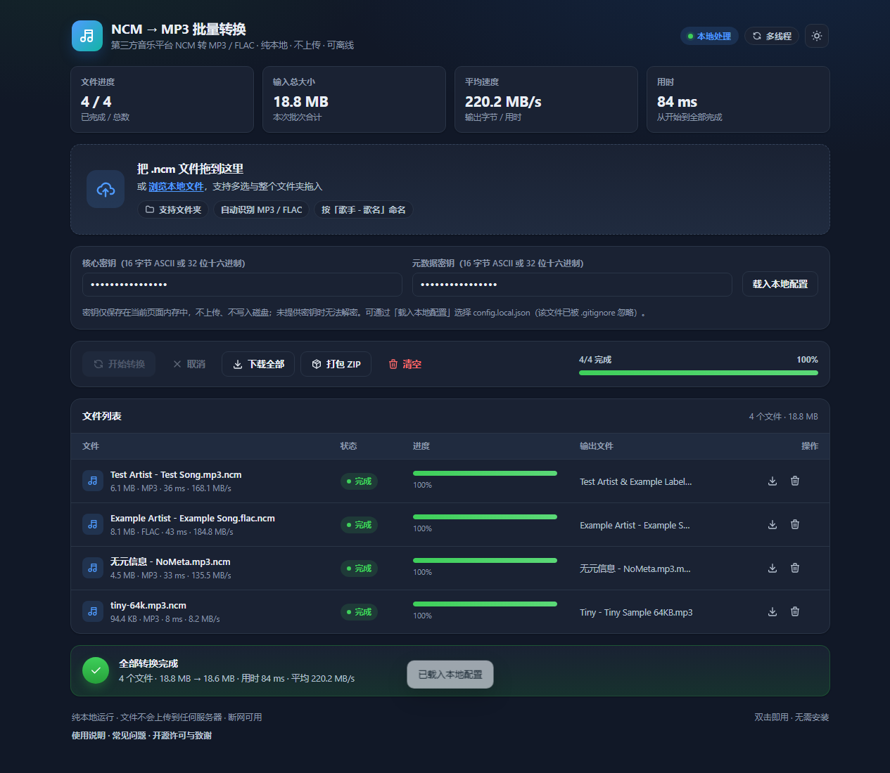

<div align="center">

# 🎵 NCM → MP3 / FLAC

**一个纯本地、离线运行的 NCM 格式转 MP3/FLAC 批量转换工具，保护隐私，拒绝上传。**

[](https://github.com/Garrion233/ncm2mp3-local/actions/workflows/ci.yml)
[](LICENSE)
[](#-技术架构)
[](#-快速开始)
[](#-核心特性)

[](docs/screenshot.png)

<sub>单文件 HTML · 双击即用 · 零外部依赖</sub>

</div>

---

## 📑 目录

<details>
<summary>点击展开 / 收起</summary>

- [📖 简介](#-简介)
- [✨ 核心特性](#-核心特性)
- [🖼️ 界面预览](#-界面预览)
- [🚀 快速开始](#-快速开始)
- [🔑 解密密钥与本地配置](#-解密密钥与本地配置)
- [🧱 技术架构](#-技术架构)
- [📊 性能与容量](#-性能与容量)
- [🧪 构建与测试](#-构建与测试)
- [📁 项目结构](#-项目结构)
- [📚 文档](#-文档)
- [⚠️ 免责声明与合规](#-免责声明与合规)
- [📄 许可证](#-许可证)
- [🙏 致谢](#-致谢)

</details>

## 📖 简介

`ncm2mp3-local` 是一个**单文件、离线、零依赖**的 NCM 批量转换工具。它把第三方音乐客户端下载的 `.ncm`
容器解析为 MP3 / FLAC，整个转换过程在浏览器本地完成，音频字节不会离开你的设备。

- 不需要安装 Node.js、不需要服务器、不需要联网；
- 不收集、不上传任何文件或使用数据；
- 支持几百个文件批量处理，界面在转换期间保持可操作。

> 本工具**不提供、不内置任何解密密钥**。密钥需由使用者自行提供，并确保对文件拥有合法使用权。

## ✨ 核心特性

- **🔒 纯离线运行**：所有转换在浏览器内存中完成；音频字节不上传、不经过任何服务器。
- **⚡ 多文件并行**：Worker 池 + 4 MiB 流式分块，主线程只负责 UI，不处理音频字节。
- **🎵 格式保真**：原始音频为 MP3 时输出 MP3，为 FLAC 时输出 FLAC（不重新编码）。
- **📦 单文件分发**：约 134 KB 的 HTML，双击即用；可直接发给他人，无需安装依赖。
- **📚 批量与 ZIP**：支持多选、整个文件夹拖入；ZIP 打包（STORE，秒级）。
- **🌗 主题与快捷键**：浅色 / 深色主题跟随系统并可记忆；`Ctrl/Cmd + O` 快速选择文件。
- **🔑 密钥本地化**：密钥不写死、不上传、不持久化；支持页面输入、本地配置文件与 CLI 参数。
- **🧪 可验证**：108 项字节级往返测试、10 项 ZIP 边界测试、17 项真实浏览器端到端测试。

## 🖼️ 界面预览

| 浅色主题 | 深色主题 |
|:---:|:---:|
|  |  |

截图中的文件与元数据均为合成测试数据（`Test Artist / Test Song / Example Album`）。

## 🚀 快速开始

### 方式一：单文件直用（推荐普通用户）

1. 下载仓库根目录的 [`ncm2mp3-batch.html`](ncm2mp3-batch.html)；
2. **双击**用 Chrome / Edge / Firefox 打开（或把 HTML 拖进浏览器窗口）；
3. 把 `.ncm` 文件或整个文件夹拖进页面；
4. 在「解密密钥」区域填入本地合法密钥（核心密钥、元数据密钥各一个）；
5. 转换完成后点「下载全部」，或点「打包 ZIP」一次性下载。

> 💡 文件较多时优先使用「打包 ZIP」；单个 ZIP 上限 4 GB，超过请分批下载。

### 方式二：命令行 / 本地开发（适合开发者）

需要 Node.js ≥ 20（仅构建与测试需要，最终用户不需要）。

```bash
# 克隆仓库
git clone https://github.com/Garrion233/ncm2mp3-local.git
cd ncm2mp3-local

# 构建单文件
node tools/build-single.mjs

# CLI 批量转换（密钥可来自命令行 / 环境变量 / config.local.json）
node cli.mjs <目录或文件> --out ./out -w 2 \
  --core-key <16 字节核心密钥> --meta-key <16 字节元数据密钥>
```

## 🔑 解密密钥与本地配置

页面需要两个 **16 字节**密钥（核心密钥、元数据密钥），支持以下形式：

- 16 字节 ASCII 字符串；
- 32 位十六进制字符串。

密钥只在当前页面内存中使用，**不上传、不写入浏览器存储、不随程序分发**。
未提供密钥时，页面会提示「请提供本地合法的解密密钥」并阻止转换。

### 本地配置文件（可选）

将 [`config.example.json`](config.example.json) 复制为 `config.local.json`：

```json
{
  "CORE_KEY": "your_key_here",
  "META_KEY": "your_key_here"
}
```

- `config.local.json` 已被 `.gitignore` 忽略，**绝不进入 Git 历史**；
- **Node CLI** 自动读取项目根目录的 `config.local.json`（优先级低于命令行参数 / 环境变量）；
- **浏览器**通过 HTTP 打开时自动尝试读取同目录 `config.local.json`；`file://` 下浏览器禁止本地
  `fetch`，请点击页面上的「载入本地配置」选择该文件；
- 仓库只提交占位模板 [`config.example.json`](config.example.json)，不含任何真实密钥。

## 🧱 技术架构

```text
Browser UI (main thread)
        │  文件队列 / 进度渲染（requestAnimationFrame）
        ▼
Worker pool（并发 min(2, CPU-1)）
        │  File.slice(4 MiB) → 解密 → 增量 CRC32 → Blob
        ▼
下载 / ZIP（STORE，Blob 零拷贝拼装）
```

- **流式分块**：任意块长、任意起点均可正确解码，峰值内存约为块大小 × 并发数；
- **增量 CRC32**：解码同一遍计算，ZIP 阶段不重复读取；
- **降级路径**：浏览器禁用 Worker 时自动切换为主线程分片 + 让出事件循环。

详细设计见 [`docs/architecture.md`](docs/architecture.md) 与 [`docs/ncm-format.md`](docs/ncm-format.md)。

## 📊 性能与容量

当前发布版（并发上限 2）在 Chrome headless 下的参考数据：

| 场景 | 结果 |
|---|---|
| 4 个文件 / 18.8 MB | 约 78 ms，长任务 0 次，最大帧间隔 16.8 ms |
| 单文件 1.5 GB | 约 7 秒（历史 6 并发测试数据） |
| 800 MB 批量（100 文件） | 约 1.4 秒（历史 6 并发测试数据） |

| 维度 | 建议 |
|---|---|
| 单文件 | ≤1 GB（8 GB 内存机器建议 ≤300–500 MB） |
| 单批文件数 | ≤500 |
| 单批总量 | ZIP 时 <4 GiB（非 ZIP64） |
| 大文件 | >1 GB 建议使用 `cli.mjs` |

完整测试方法、数据与局限见 [`docs/performance.md`](docs/performance.md)。

## 🧪 构建与测试

```bash
# 生成确定性测试样本（约 42 MB，使用合成测试密钥）
node tools/make-fixtures.mjs --out fixtures --profile default

node tests/roundtrip.mjs      # 字节级往返 + 9 种块长一致性（108 项）
node tests/limits.mjs         # ZIP 4 GiB / 65,535 条目边界（10 项）
node tools/build-single.mjs   # 构建单文件（CI 校验与已提交产物一致）
node tools/verify-single.mjs  # 真实 Chrome + file:// 端到端（17 项）
```

CI 在 Node 20/22 上执行：构建 → 产物可复现校验 → 禁止内置密钥导出检查 →
合成样本生成 → 往返测试 → ZIP 边界测试 → CLI 冒烟测试 → 上传构建产物。

## 📁 项目结构

```text
ncm2mp3-local/
├─ ncm2mp3-batch.html     单文件成品（构建产物，随仓库提交并由 CI 校验）
├─ config.example.json    本地配置文件占位模板（真实配置 config.local.json 已 gitignore）
├─ cli.mjs                Node 批量转换 CLI
├─ src/                   核心与页面源码
│  ├─ ncm.js  aes.js  crc32.js  zip.js
│  └─ worker.js  final-app.js  template.html
├─ tools/                 构建、测试夹具、验证脚本、本地配置加载器
├─ tests/                 往返与 ZIP 边界测试
├─ docs/                  架构、格式说明、性能、第三方许可
└─ .github/workflows/     CI
```

## 📚 文档

| 文档 | 内容 |
|---|---|
| [`docs/architecture.md`](docs/architecture.md) | 架构、Worker 协议、ZIP 设计、内存模型 |
| [`docs/ncm-format.md`](docs/ncm-format.md) | NCM 容器结构、字段语义、格式嗅探 |
| [`docs/performance.md`](docs/performance.md) | 性能测试方法、数据、容量边界 |
| [`docs/THIRD_PARTY_NOTICES.md`](docs/THIRD_PARTY_NOTICES.md) | 第三方组件与 MIT 许可证全文 |

## ⚠️ 免责声明与合规

> **⚠️ 注意：**
> - **本工具不提供、不内置任何解密密钥。** 解密所需的密钥须由使用者自行提供，并确保对文件拥有合法使用权。
> - **请勿用于侵犯版权或盗版传播等违法违规用途。**
> - 本仓库不包含、不提供、也不分发任何受版权保护的音乐或音频文件。

> **合规声明**
> 本项目仅用于计算机文件格式分析与前端技术交流。用户需自行确保拥有音频文件的合法使用权，并自行提供解密所需的密钥。因使用本工具产生的任何法律纠纷与开发者无关。

- 请仅转换你本人合法拥有的文件，并遵守所在地区法律法规与相关音乐平台的用户服务协议；
- 本项目与任何音乐平台均无隶属、合作或授权关系；
- 部分司法辖区可能限制规避技术措施的行为，若你所在地区适用相关法律，请勿使用本项目。

**Disclaimer (English)**: This project performs local format analysis and conversion only. It does not
include, host, or distribute any music content, lyrics, keys, or third-party site code. Use it only
with files you legally own. No affiliation with any music platform. Use at your own risk.

## 📄 许可证

本项目代码采用 [MIT License](LICENSE) 发布，Copyright © 2026 Garrion。

UI 设计参考 **Tabler**（MIT，© 2018–2026 The Tabler Authors，v1.7.3），
图标来自 **Tabler Icons**（MIT，© 2020–2026 Paweł Kuna，v3.50.0）；
版权、版本、commit 与修改说明见 [`docs/THIRD_PARTY_NOTICES.md`](docs/THIRD_PARTY_NOTICES.md)。

## 🙏 致谢

- [Tabler](https://github.com/tabler/tabler) — UI 设计语言参考；
- [Tabler Icons](https://github.com/tabler/tabler-icons) — 界面图标；
- [taurusxin/ncmdump](https://github.com/taurusxin/ncmdump)、
  [unlock-music](https://github.com/ix64/unlock-music)、
  [ncm2mp3-core](https://crates.io/crates/ncm2mp3-core) — 格式研究与交叉验证参考（未复制其代码）。
