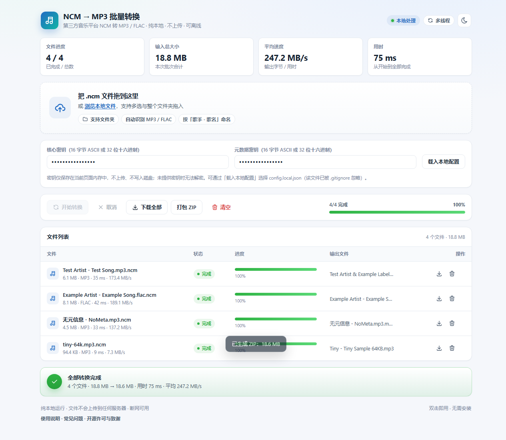
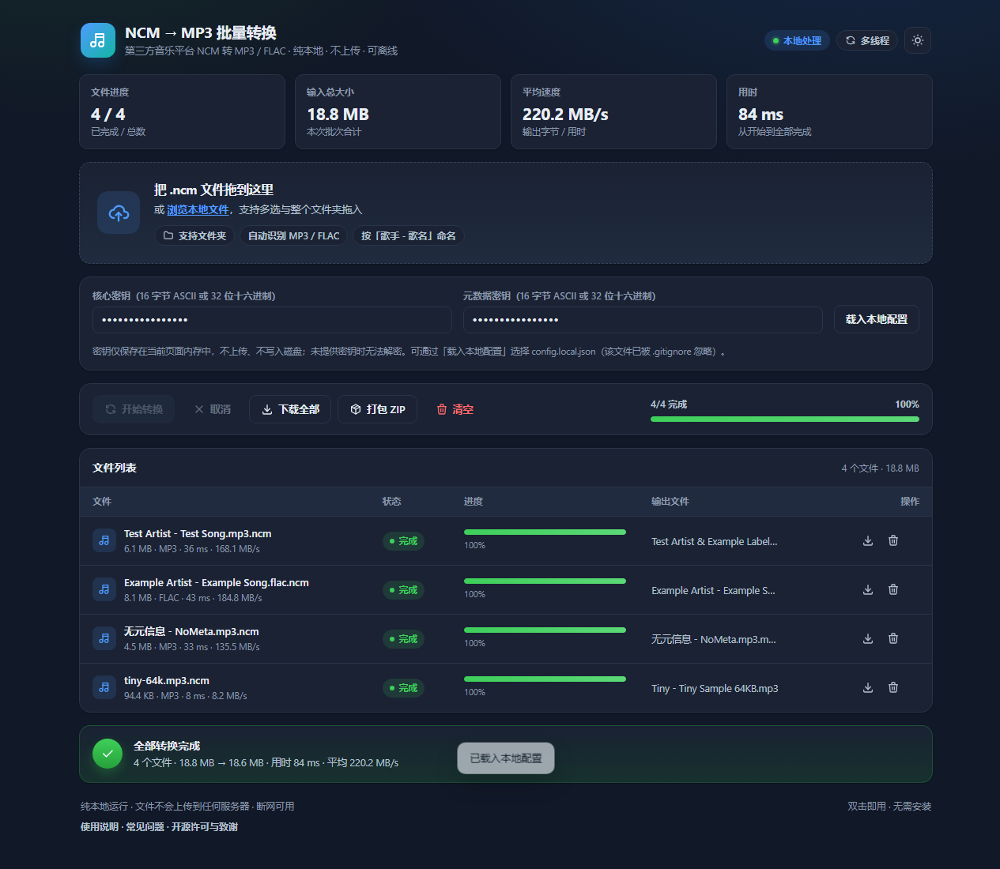

# 🎵 NCM → MP3 / FLAC

**一个纯本地、离线运行的 NCM 格式转 MP3/FLAC 批量转换工具，保护隐私，拒绝上传。**

📢 讨论群：[**Telegram 讨论群**](https://t.me/+oVST2imwbco4ZTM1)

单文件 HTML · 双击即用 · 无需安装

---

## 📑 目录

展开目录 / 收起

- [📖 简介](#-简介)
- [✨ 为什么好用](#-为什么好用)
- [🖼️ 界面预览](#-界面预览)
- [🚀 快速开始](#-快速开始)
- [🔑 关于密钥](#-关于密钥)
- [📊 性能与容量](#-性能与容量)
- [❓ 常见问题](#-常见问题)
- [⚠️ 免责声明与合规](#-免责声明与合规)
- [📄 许可证](#-许可证)
- [🙏 致谢](#-致谢)

## 📖 简介

`ncm2mp3-local` 是一个单文件、离线运行的 NCM 批量转换工具。它可以把第三方音乐客户端下载的
`.ncm` 文件转换为 MP3 / FLAC，整个转换过程都在浏览器本地完成。

- 不需要安装软件，不需要服务器，不需要联网；
- 不收集、不上传任何文件或使用数据；
- 支持多选、拖入整个文件夹、批量打包下载；
- 转换在后台进行，处理期间页面仍可正常操作。

📢 讨论群：[**Telegram 讨论群**](https://t.me/+oVST2imwbco4ZTM1)

## ✨ 为什么好用

- **🔒 不上传**：所有转换都在你的电脑上完成，文件不会离开浏览器。
- **⚡ 批量不卡**：后台处理多个文件，转换期间界面保持可操作。
- **🎵 音质不变**：原始音频是 MP3 就输出 MP3，是 FLAC 就输出 FLAC，不重新编码。
- **📦 单文件分发**：一个约 134 KB 的 HTML，双击即用，也可以直接发给朋友。
- **📚 文件夹与 ZIP**：支持整个文件夹拖入，多个结果可一键打包下载。
- **🌗 浅色 / 深色主题**：跟随系统主题，`Ctrl/Cmd + O` 快速选择文件。

## 🖼️ 界面预览

| 浅色主题 | 深色主题 |
|:---:|:---:|
|  |  |

截图中的文件与信息均为示例数据，不是真实音乐。

## 🚀 快速开始

1. 下载 [`ncm2mp3-batch.html`](ncm2mp3-batch.html)；
2. **双击**用 Chrome / Edge / Firefox 打开，或把 HTML 拖进浏览器窗口；
3. 把 `.ncm` 文件或整个文件夹拖进页面；
4. 在「解密密钥」区域填入你的本地密钥；
5. 转换完成后点「下载全部」，或点「打包 ZIP」一次性下载。

> 💡 文件较多时建议使用「打包 ZIP」；单个 ZIP 上限为 4 GB，超过请分批下载。

## 🔑 关于密钥

转换需要两个 **16 字节**密钥（核心密钥、元数据密钥），支持 16 字节 ASCII 或 32 位十六进制格式。

- 密钥只用于当前页面内的转换，**不会上传、不会写入浏览器存储**；
- 未填写密钥时无法开始转换，页面会给出提示；
- 本工具**不提供、不内置任何密钥**，请使用你自行合法取得的密钥。

## 📊 性能与容量

| 场景 | 参考结果 |
|---|---|
| 4 个文件 / 18.8 MB | 约 78 ms，转换期间无界面卡顿 |
| 单文件 1.5 GB | 可正常处理（约 7 秒，参考值） |

| 建议 | 说明 |
|---|---|
| 单文件 ≤1 GB | 内存 8 GB 的电脑建议 300–500 MB 以内 |
| 单批 ≤500 个 | 文件很多时优先使用「打包 ZIP」 |
| ZIP <4 GB | 超过请分批下载 |

## ❓ 常见问题

**Q：为什么需要密钥？没有密钥能用吗？**
A：`.ncm` 文件包含加密层，需要密钥才能还原音频。本工具不提供密钥；没有密钥时无法转换。

**Q：文件会被上传吗？**
A：不会。页面没有网络请求，所有处理都在你的浏览器内存中完成。

**Q：支持哪些浏览器？**
A：Chrome / Edge 90+、Firefox 90+、Safari 16+。

**Q：转换后的文件无法播放？**
A：请确认原始 `.ncm` 文件完整；文件本身损坏时无法恢复。

**Q：支持哪些输出格式？**
A：输出格式由原始音频决定：原始为 MP3 时输出 MP3，原始为 FLAC 时输出 FLAC。

## ⚠️ 免责声明与合规

> **⚠️ 注意：**
> - **本工具不提供、不内置任何解密密钥。** 解密所需的密钥须由使用者自行提供，并确保对文件拥有合法使用权。
> - **请勿用于侵犯版权或盗版传播等违法违规用途。**
> - 本仓库不包含、不提供、也不分发任何受版权保护的音乐或音频文件。

> **合规声明**
> 本项目仅用于计算机文件格式分析与前端技术交流。用户需自行确保拥有音频文件的合法使用权，并自行提供解密所需的密钥。因使用本工具产生的任何法律纠纷与开发者无关。

- 请仅转换你本人合法拥有的文件，并遵守所在地区法律法规与相关音乐平台的用户服务协议；
- 本项目与任何音乐平台均无隶属、合作或授权关系；
- 部分司法辖区可能限制规避技术措施的行为；若你所在地区适用相关法律，请勿使用本项目。

**Disclaimer (English)**: This project performs local format analysis and conversion only. It does not
include, host, or distribute any music content, lyrics, keys, or third-party site code. Use it only
with files you legally own. No affiliation with any music platform. Use at your own risk.

## 📄 许可证

本项目代码采用 [MIT License](LICENSE) 发布，Copyright © 2026 Garrion。

UI 设计参考 **Tabler**（MIT，© 2018–2026 The Tabler Authors），
图标来自 **Tabler Icons**（MIT，© 2020–2026 Paweł Kuna）；
版权与许可说明见 [`docs/THIRD_PARTY_NOTICES.md`](docs/THIRD_PARTY_NOTICES.md)。

## 🙏 致谢

- [Tabler](https://github.com/tabler/tabler) — UI 设计语言参考；
- [Tabler Icons](https://github.com/tabler/tabler-icons) — 界面图标；
- [taurusxin/ncmdump](https://github.com/taurusxin/ncmdump)、
  [ncm2mp3-core](https://crates.io/crates/ncm2mp3-core) — 格式研究与交叉验证参考（未复制其代码）。
